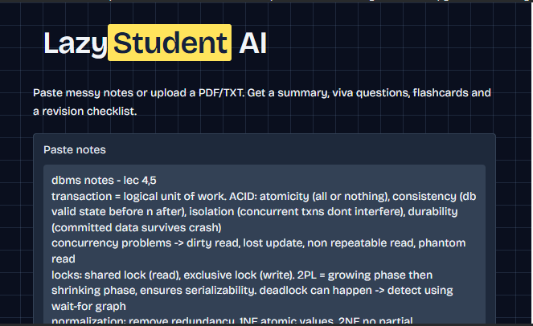
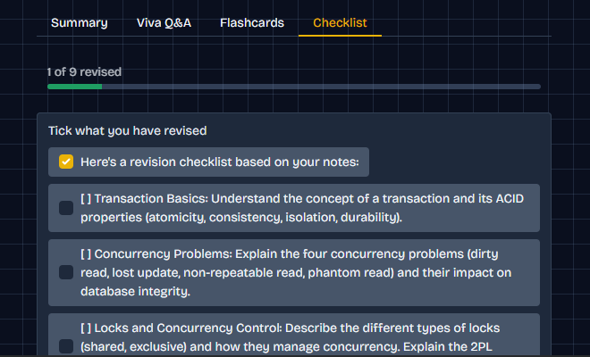
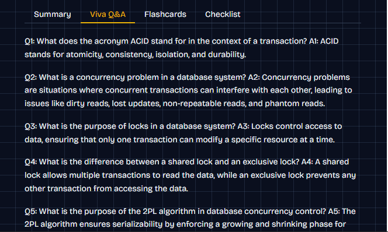
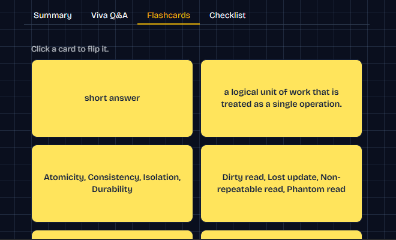

# 🦥 LazyStudentAI — Your Smart Study Assistant

**Study smarter, not harder!**

LazyStudentAI is an AI-powered study assistant that transforms messy study notes into organized learning resources, helping students prepare for exams and revise concepts more efficiently.

Built for the **Hacktoberfest 2026 Open-Source AI Challenge — Week 3: Slow and Steady**.

## 📌 Table of Contents

- [About the Project](#-about-the-project)
- [Features](#-features)
- [Project Screenshots](#-project-screenshots)
- [How It Works](#-how-it-works)
- [Technology Stack](#️-technology-stack)
- [Getting Started](#-getting-started)
- [Why Open-Source AI](#-why-open-source-ai)
- [Future Improvements](#-future-improvements)
- [Hacktoberfest Challenge](#-hacktoberfest-challenge)
- [Author](#-author)
- [License](#-license)

## 🎯 About the Project

Students often spend a lot of time organizing lecture notes, preparing viva questions, creating flashcards, and planning revision.

LazyStudentAI aims to simplify these repetitive tasks through an easy-to-use interface.

Paste your notes or upload a supported PDF or TXT file to generate a study pack containing a summary, viva questions and answers, flashcards, and a revision checklist.

## ✨ Features

### 📝 1. Smart Study Material Input
- Paste messy or unorganized study notes.
- Upload supported PDF or TXT files.
- Turn study material into structured learning resources.

### 📚 2. AI-Generated Summary
- Summarize important concepts.
- Make lengthy study material easier to revise.
- Focus on key points.

### 🎓 3. Viva Questions and Answers
- Generate practice questions from study notes.
- Review answers to important concepts.
- Prepare for college practicals and viva examinations.

### 🗂️ 4. Interactive Flashcards
- Revise concepts using question-and-answer cards.
- Flip cards to reveal answers.
- Practice important definitions and concepts.

### ✅ 5. Revision Checklist
- Organize topics into revision tasks.
- Mark topics as completed.
- Track revision progress using a progress indicator.

## 📸 Project Screenshots

### 1. Study Material Input



### 2. Revision Checklist



### 3. Viva Questions and Answers



### 4. Interactive Flashcards



## ⚙️ How It Works

1. Open the LazyStudentAI application.
2. Paste your study notes or upload a supported document.
3. Click **Make my study pack**.
4. Explore the generated summary, viva questions and answers, flashcards, and revision checklist.
5. Use the checklist to track your revision.

## 🛠️ Technology Stack

The project uses Python and a Google Colab notebook as its development environment.

Depending on the actual notebook implementation, the technology stack may include:

- **Python** — Core programming language.
- **Google Colab** — Notebook development and execution.
- **Hugging Face Transformers** — Language-model integration, if used.
- **Open-weight language model** — AI-powered text generation, if used.
- **Gradio or another UI framework** — User interface, if used.

*Update this list to match the libraries, model, and interface actually used in the notebook.*

## 🚀 Getting Started

### Option 1: Run using Google Colab

1. Open the [LazyStudentAI repository](https://github.com/tk1981215/LazyStudentAI).
2. Click `LazyStudentAi.ipynb`.
3. Download the notebook or open it in Google Colab.
4. Follow the setup instructions provided in the notebook.
5. Run the cells in order.
6. Enter your study material and generate a study pack.

### Option 2: Run locally

Clone the repository:

```bash
git clone https://github.com/tk1981215/LazyStudentAI.git
cd LazyStudentAI
```

Install the dependencies required by the notebook, then run it using Jupyter Notebook or JupyterLab.

For example, if Jupyter is installed:

```bash
jupyter notebook LazyStudentAi.ipynb
```

*Local execution requires the necessary Python dependencies, model access, and hardware resources.*

## 🌱 Why Open-Source AI?

Open-source software and accessible open-weight models make AI development more flexible and approachable for students and independent developers.

LazyStudentAI provides an opportunity to:

- Experiment with AI-powered learning tools.
- Customize prompts and model behavior.
- Learn how language models work in practical applications.
- Explore local inference and privacy-conscious processing.

Offline operation and data privacy depend on the selected model and deployment configuration.

## 🔮 Future Improvements

- Export study packs as PDF files.
- Add subject-wise organization.
- Save and revisit previous study packs.
- Support additional document formats.
- Improve the accuracy of generated answers.
- Add personalized revision recommendations.

## 🏆 Hacktoberfest Challenge

LazyStudentAI is inspired by the theme **Slow and Steady**: use AI to automate repetitive tasks and make everyday learning easier.

Challenge: [Hacktoberfest Open-Source AI Challenge — Week 3](https://dev.to/challenges/hacktoberfest-week3-2026-10-19)

## 👩‍💻 Author

**GitHub:** [@tk1981215](https://github.com/tk1981215)

## 📄 License

A project license has not yet been specified. Add a suitable `LICENSE` file if you want to define how others may use, modify, and distribute this project.

---

⭐ If you find this project useful, consider starring the repository!
